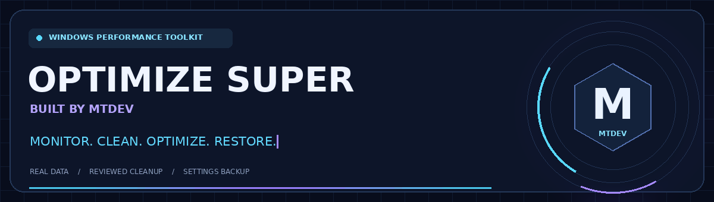

<div align="center">

# ⚡ OPTIMIZE SUPER | MTDEV

**Windows Performance Toolkit · Bộ công cụ quản lý hiệu năng Windows**

**Monitor • Clean • Optimize • Restore**


### [🇻🇳 Tiếng Việt](#vietnamese) · [🇬🇧 English](#english)

[🖥️ Screenshots](#screenshots) · [📦 Build EXE](#build) · [🐛 Issues](https://github.com/mtdevvn/Super-optimizer-MTDEV/issues) · [⭐ Repository](https://github.com/mtdevvn/Super-optimizer-MTDEV)

</div>

---

<a name="vietnamese"></a>
## 🇻🇳 Tiếng Việt

### 💎 Giới thiệu

**OPTIMIZE SUPER | MTDEV** là ứng dụng desktop Python dành cho việc theo dõi và quản lý hiệu năng Windows. Giao diện dark/light sử dụng tông xanh neon và tím, với các công cụ dọn dẹp, kiểm tra tiến trình, quản lý startup và khôi phục cài đặt đã lưu.

**Dữ liệu thực · Xem trước khi dọn · Sao lưu trước khi đổi cài đặt.**

> **Trạng thái:** mã nguồn ứng dụng đã được triển khai. Bản mã nguồn ban đầu có **19 kiểm thử tự động chạy thành công trên Linux**. Các tích hợp Windows và bản `.exe` cần được kiểm thử trên Windows 10/11 trước khi phát hành. Đây không phải huy hiệu CI hay chứng nhận tương thích Windows.

### ✨ Tính năng

| Công cụ | Chức năng |
| :--- | :--- |
| 📊 **Dashboard** | Xem CPU, RAM, ổ đĩa, tốc độ mạng, uptime và thông tin phần cứng từ hệ thống. |
| ⚡ **Super Optimize** | Chọn riêng thao tác dọn file tạm, kiểm tra startup/tiến trình, giảm animation Windows và đổi power plan được hỗ trợ. |
| 🎮 **Gaming Boost** | Hướng dẫn Game Mode, chẩn đoán GPU scheduling, thêm game và lưu power profile tùy chọn. |
| 🧠 **RAM Management** | Xem ứng dụng dùng nhiều RAM, đóng ứng dụng được chọn sau xác nhận, theo dõi bộ nhớ trước/hiện tại. |
| 🧹 **Storage Cleaner** | Quét vị trí Temp/cache được hỗ trợ và Recycle Bin; xem đường dẫn, dung lượng trước khi xóa. |
| 🔎 **File Analysis** | Quét file từ 100 MB và nhóm file trùng bằng SHA-256; không tự xóa file cá nhân. |
| 🚀 **Startup Manager** | Xem Run keys/Startup folders, tắt mục đã chọn và khôi phục cấu hình đã lưu. |
| ⚙️ **Process Manager** | Tìm, sắp xếp CPU/RAM và đóng tiến trình người dùng được phép sau khi xác nhận. |
| 🌐 **Network Tools** | Xem kết nối, đổi IPv4 DNS sang Cloudflare/Google, flush DNS và khôi phục cấu hình gốc. |
| 🛠️ **Windows Tools** | Mở Windows Update, Device Manager, Task Manager, Security, Power Options và System Restore. |
| 🛡️ **Restore Center** | Nhật ký thao tác, undo hỗ trợ, xuất báo cáo và tạo restore point khi Windows cho phép. |
| 🎨 **Settings** | Dark/light, điều hướng Việt/Anh, chuyển trang, system tray và lịch quét khi ứng dụng đang chạy. |

### 🚀 Cài đặt nhanh

**Cách 1 — Không dùng Git**

1. Chọn **Code → Download ZIP** trên GitHub, sau đó giải nén.
2. Cài [Python 3.11 x64](https://www.python.org/downloads/windows/) với Python Launcher.
3. Mở thư mục chứa `main.py`, nhấp đúp **`launch_windows.bat`**.
4. Đợi cài thư viện lần đầu; giao diện ứng dụng sẽ tự mở sau khi hoàn tất.

**Cách 2 — Dùng Git và Terminal**

```powershell
git clone https://github.com/mtdevvn/Super-optimizer-MTDEV.git
cd Super-optimizer-MTDEV
py -3.11 -m venv .venv
.venv\Scripts\python.exe -m pip install -r requirements.txt
.venv\Scripts\python.exe main.py
```

Lần cài thư viện đầu tiên cần Internet. Sau khi cài xong, các chức năng cốt lõi hoạt động offline. Lệnh/script mặc định dùng Python 3.11; nếu cài phiên bản mới hơn, thay `-3.11` cho phù hợp.

### 🎮 Sử dụng

1. Mở **Dashboard** để xem tình trạng hệ thống.
2. Vào **Storage Cleaner**, chọn vị trí và chạy quét.
3. Xem đường dẫn/dung lượng, bỏ chọn file muốn giữ rồi xác nhận danh sách cần xóa.
4. Với **Super Optimize**, chọn từng thao tác phù hợp trước khi chạy.
5. Xem báo cáo và dùng **Restore Center** để hoàn tác các thay đổi có hỗ trợ.

Bắt đầu bằng quyền người dùng thông thường. Nếu thao tác yêu cầu quyền cao hơn, dùng **Settings → Restart as administrator** và xác nhận UAC bằng cùng tài khoản.

### 🛡️ An toàn và phạm vi hỗ trợ

- Dọn dẹp chỉ đề xuất các file phù hợp từ vị trí hỗ trợ, ít nhất **48 giờ tuổi**; file thực thi, liên kết và file thay đổi sau quét được loại trừ theo chính sách của cleaner.
- Lưu trạng thái ban đầu trước thay đổi registry, DNS, power plan, startup và tùy chọn animation được quản lý.
- Bảo vệ tiến trình Windows, service/session-0, tiến trình được bảo vệ và tiến trình người dùng khác; không tự đóng tiến trình trong Super Optimize.
- Không cung cấp thao tác tắt Defender, Firewall, Windows Update hay dịch vụ thiết yếu.
- Quét tự động chỉ chạy khi app đang mở và vẫn yêu cầu xem lại trước khi xóa.
- Sensor không hỗ trợ sẽ hiện **Unavailable**. GPU usage/temperature hiện dùng `nvidia-smi` nếu khả dụng cho GPU NVIDIA đầu tiên; AMD/Intel có thể chỉ hiển thị tên GPU.
- Browser cache tùy chọn giới hạn ở disk cache của profile mặc định Chrome/Edge; cần đóng trình duyệt trước khi dọn.
- Startup Manager quản lý Run keys và Startup folders, không bao phủ toàn bộ services, scheduled tasks hay packaged startup apps.
- Điều hướng hỗ trợ Việt/Anh; mô tả kỹ thuật và báo cáo trong ứng dụng vẫn bằng tiếng Anh.
- Không tạo số FPS giả hoặc cam kết tăng FPS. Đổi DNS không bảo đảm giảm ping.

> **Xóa file và làm trống Recycle Bin không thể hoàn tác bằng ứng dụng.** Đóng tiến trình có thể làm mất công việc chưa lưu. Restore Center chỉ khôi phục các cài đặt đã lưu có hỗ trợ, không reset toàn bộ Windows.

Dữ liệu cá nhân của ứng dụng nằm tại `%LOCALAPPDATA%\MTDEV\OptimizeSuper\`. Giữ lại backup nếu muốn hoàn tác và không đưa log/backup riêng lên GitHub công khai.

<details>
<summary><b>❓ Chạy BAT nhưng chưa thấy giao diện?</b></summary>

Mở CMD tại thư mục chứa `main.py`:

```bat
py -3.11 --version
call launch_windows.bat
```

Giữ nguyên cửa sổ lỗi và gửi nội dung thông báo khi cần hỗ trợ. Không gửi token, mật khẩu hoặc thông tin cá nhân trong log.

</details>

<div align="right">

[⬆ Về đầu trang](#) · [🇬🇧 Read in English](#english)

</div>

---

<a name="english"></a>
## 🇬🇧 English

### 💎 Overview

**OPTIMIZE SUPER | MTDEV** is a Python desktop application for Windows performance monitoring and management. It combines a dark/light interface with neon blue and purple accents, reviewed cleanup, process inspection, startup management and recovery for supported settings.

**Real system data · Review before cleanup · Back up before changing settings.**

> **Project status:** application source is implemented. The original source package passed **19 automated tests on Linux**. Windows integrations and the frozen `.exe` still require validation on Windows 10/11 before release. This is not a live CI result or Windows compatibility certification.

### ✨ Features

| Tool | Functionality |
| :--- | :--- |
| 📊 **Dashboard** | Actual CPU, RAM, disk usage, network rates, uptime and hardware information. |
| ⚡ **Super Optimize** | Individually selectable temporary cleanup, startup/process audits, Windows animation preference and supported power-plan changes. |
| 🎮 **Gaming Boost** | Game Mode guidance, GPU scheduling diagnostics, a game list and optional power profiles. |
| 🧠 **RAM Management** | Memory-heavy application list, confirmed application close and real before/current memory readings. |
| 🧹 **Storage Cleaner** | Supported temporary/cache locations and Recycle Bin, with full paths and sizes before deletion. |
| 🔎 **File Analysis** | Read-only scanning for files of 100 MB or larger and SHA-256 duplicate groups. |
| 🚀 **Startup Manager** | Registry Run keys and Startup folders, with backup and restore for disabled entries. |
| ⚙️ **Process Manager** | Searchable and sortable CPU/RAM information, with confirmed termination of eligible user processes. |
| 🌐 **Network Tools** | Connection information, Cloudflare/Google IPv4 DNS profiles, resolver-cache flush and original configuration restore. |
| 🛠️ **Windows Tools** | Shortcuts to Update, Device Manager, Task Manager, Security, Power Options and System Restore. |
| 🛡️ **Restore Center** | Operation history, supported undo, report export and Windows restore points when permitted. |
| 🎨 **Settings** | Dark/light themes, English/Vietnamese navigation, transitions, system tray and app-running cleanup scan scheduling. |

### 🚀 Installation

**Option 1 — Download ZIP**

1. Select **Code → Download ZIP** and extract the archive.
2. Install [Python 3.11 x64](https://www.python.org/downloads/windows/), including the Python Launcher.
3. Open the folder containing `main.py` and double-click **`launch_windows.bat`**.
4. Wait for first-run dependency installation; the application opens afterward.

**Option 2 — Git and Terminal**

```powershell
git clone https://github.com/mtdevvn/Super-optimizer-MTDEV.git
cd Super-optimizer-MTDEV
py -3.11 -m venv .venv
.venv\Scripts\python.exe -m pip install -r requirements.txt
.venv\Scripts\python.exe main.py
```

Internet access is required for the initial dependency installation. Core features run offline afterward. Scripts default to Python 3.11; adjust `-3.11` if using a newer installed version.

### 🎮 Usage

1. Open **Dashboard** to inspect current system activity.
2. Open **Storage Cleaner**, choose locations and start a scan.
3. Review paths and sizes, uncheck files to retain and confirm the selected files.
4. In **Super Optimize**, select the individual operations you want to run.
5. Review the report and use **Restore Center** to undo supported configuration changes.

Start with ordinary user privileges. If an operation requires elevation, use **Settings → Restart as administrator** and approve the Windows UAC prompt with the same account.

### 🛡️ Safety and support scope

- Cleanup proposes eligible files at least **48 hours old** in supported locations. Executables, linked paths and files changed after scanning are excluded by the cleaner policy.
- Original states are saved before managed registry, DNS, power-plan, startup and animation-preference changes.
- Windows, service/session-0, protected and other-user processes are blocked. Super Optimize never closes processes automatically.
- The app provides no operation to disable Defender, Firewall, Windows Update or essential services.
- Automatic scans run only while the application is open and still require review before deletion.
- Unsupported sensors display **Unavailable**. GPU utilization/temperature currently require an available `nvidia-smi` for the first NVIDIA GPU. AMD/Intel may show identity only.
- Optional browser cleanup covers default-profile Chrome/Edge disk caches; browsers must be closed first.
- Startup management covers Run keys and Startup folders, not all services, scheduled tasks or packaged startup apps.
- Navigation supports English/Vietnamese; technical descriptions and reports inside the application remain in English.
- No fake FPS readings or guaranteed FPS gains. DNS changes do not guarantee lower gaming ping.

> **File cleanup and Recycle Bin emptying cannot be undone by this application.** Closing a process may discard unsaved work. Restore Center restores supported saved settings; it does not reset all Windows configuration.

Application data is stored under `%LOCALAPPDATA%\MTDEV\OptimizeSuper\`. Retain backups for undo support, and keep personal logs/backups out of public repositories.

<details>
<summary><b>❓ The BAT file ran, but no application window appeared?</b></summary>

Open CMD in the folder containing `main.py`:

```bat
py -3.11 --version
call launch_windows.bat
```

Keep the error window open and include the message in a support request. Do not share passwords, tokens or personal data from logs.

</details>

<div align="right">

[⬆ Back to top](#) · [🇻🇳 Đọc tiếng Việt](#vietnamese)

</div>

---

<a name="screenshots"></a>
## 🖥️ Giao diện / Screenshots

**VI:** Các ảnh dưới đây là giao diện chụp trên máy kiểm thử Linux, sử dụng dữ liệu thực của máy kiểm thử; không phải bằng chứng đã kiểm thử tích hợp Windows.

**EN:** These screenshots show actual Linux test-host telemetry and the rendered interface. They are not evidence of Windows integration validation.


<details>
<summary><b>🌙 Xem thêm / More screenshots</b></summary>

### Super Optimize


### Light Mode


</details>

<a name="build"></a>
## 📦 Tạo EXE / Build an executable

**VI:** Build trên **Windows với Python x64** bằng `build_windows.bat` hoặc các lệnh dưới đây. Kiểm tra bản build trên Windows 10/11 sạch trước khi chia sẻ.

**EN:** Build **on Windows with x64 Python**, using `build_windows.bat` or the commands below. Validate on clean Windows 10/11 systems before distribution.

```powershell
py -3.11 -m venv .venv
.venv\Scripts\python.exe -m pip install -r requirements-dev.txt
.venv\Scripts\python.exe -m pytest -q
.venv\Scripts\python.exe -m PyInstaller --clean --noconfirm OptimizeSuper.spec
```

**Đầu ra / Output:**

```text
dist\OptimizeSuper-MTDEV.exe
```

**VI:** Cấu hình đóng gói bao gồm Python và thư viện cần thiết để máy đích không phải cài Python riêng. Kho mã nguồn chưa đồng nghĩa với một bản EXE đã được kiểm chứng.

**EN:** The packaging configuration bundles Python and required libraries so end users do not need a separate Python installation. A source repository does not imply a verified executable release is available.

## 🧩 Công nghệ / Technology

| Thành phần / Component | Vai trò / Role |
| :--- | :--- |
| **Python 3.11+** | Ngôn ngữ chính / Application language. |
| **PySide6 / Qt** | Giao diện / Desktop interface. |
| **psutil** | Dữ liệu hệ thống / System telemetry. |
| **QThread / QThreadPool** | Tác vụ nền / Background processing. |
| **Windows APIs / PowerShell** | Tích hợp Windows / Windows integration. |
| **PyInstaller** | Đóng gói EXE / Executable packaging. |

## 📚 Tài liệu / Documentation

- [Báo cáo kiểm thử / Test report](./docs/TEST_REPORT.md)
- [Checklist Windows / Windows acceptance checks](./docs/WINDOWS_ACCEPTANCE.md)
- [Tài liệu kỹ thuật / Technical guide](./docs/TECHNICAL_GUIDE.md)

## 🤝 Góp ý / Contributing

**VI:** Mở [issue](https://github.com/mtdevvn/Super-optimizer-MTDEV/issues) kèm phiên bản Windows/Python, bước tái hiện và thông báo lỗi. Pull request nên mô tả thay đổi và cách kiểm tra.

**EN:** Open an [issue](https://github.com/mtdevvn/Super-optimizer-MTDEV/issues) with Windows/Python versions, reproduction steps and error output. Pull requests should explain the change and its validation.

---

<div align="center">

### ◈ MTDEV

**OPTIMIZE SUPER — Performance, with control.**

Developed by [**mtdevvn**](https://github.com/mtdevvn) · [Repository](https://github.com/mtdevvn/Super-optimizer-MTDEV) · [Report an issue](https://github.com/mtdevvn/Super-optimizer-MTDEV/issues)

**Nếu thấy hữu ích, hãy ⭐ Star / If you find it useful, leave a ⭐ Star.**

[⬆ Trở về đầu trang / Back to top](#)

</div>
